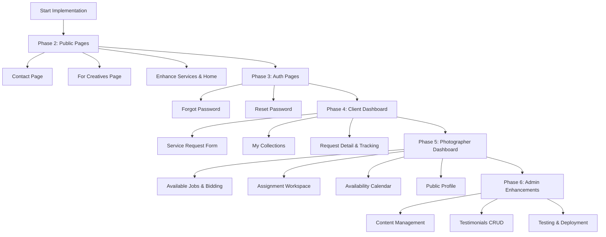

# Bits Photo Mart - Implementation Gap Analysis & Roadmap

## Project Status Summary

| Phase | Status | Completion |
|-------|--------|-------------|
| Phase 1: Project Setup | ✅ Complete | 100% |
| Phase 2: Public Pages | ⚠️ Partial | ~75% |
| Phase 3: Auth Pages | ⚠️ Partial | ~60% |
| Phase 4: Client Dashboard | ⚠️ Partial | ~50% |
| Phase 5: Photographer Dashboard | ⚠️ Partial | ~55% |
| Phase 6: Admin Panel | ✅ Mostly Complete | ~90% |

---

## Phase 2: Public Pages - Missing Items

### 2.1 Contact Page (HIGH PRIORITY)
- **Location**: `app/contact/page.tsx`
- **Required Components**:
  - Contact information (email, phone, location)
  - Contact form with fields: Name, Email, Phone, Service interest dropdown, Message
  - "Request a Quote" CTA
  - Map embed (optional)
  - Social media links (Instagram, Facebook, YouTube, TikTok)

### 2.2 For Creatives Page (HIGH PRIORITY)
- **Location**: `app/for-creatives/page.tsx`
- **Required Components**:
  - Hero Section: "Earn from Your Creative Talent" headline
  - What You Get (benefits cards): 5 benefits
  - How It Works (5-step process)
  - Contributor Benefits: 50-60% commission, featured collections, training, fast payouts
  - What We Accept: 4K/HD video, African imagery, drone footage, editorial photos
  - Contributor Onboarding Steps
  - "Register Now" CTA button

### 2.3 Services Page Enhancement
- **Location**: `app/services/page.tsx`
- **Add Sections**:
  - Documentary Production section with CTA
  - Corporate Media Packages section
  - Better integration with all CTAs

### 2.4 Homepage Enhancement
- **Location**: `app/page.tsx`
- **Add Sections**:
  - Featured Gallery (6-12 images with hover effects)
  - Get Started CTA section

---

## Phase 3: Authentication Pages - Missing Items

### 3.1 Forgot Password Page
- **Location**: `app/forgot-password/page.tsx`
- **Required Components**:
  - Email field
  - "Send reset link" button
  - Back to login link

### 3.2 Reset Password Page
- **Location**: `app/reset-password/page.tsx`
- **Required Components**:
  - New password field
  - Confirm password field
  - Update password button

---

## Phase 4: Client Dashboard - Missing Items

### 4.1 Service Request Page (HIGH PRIORITY)
- **Location**: `app/dashboard/request/page.tsx`
- **Required Components**:
  - Multi-step form:
    - Step 1: Service type selection (Event coverage, Documentary, Custom shoot)
    - Step 2: Event details (title, description, date, location, county)
    - Step 3: Budget input
    - Step 4: File upload for references
    - Step 5: Review and submit
  - Success confirmation

### 4.2 My Collections Page
- **Location**: `app/dashboard/collections/page.tsx`
- **Required Components**:
  - Create collection button
  - Collections list
  - Saved media grid
  - Remove from collection functionality
  - Add to cart functionality

### 4.3 Enhanced My Requests
- **Location**: `app/dashboard/requests/page.tsx`
- **Add**:
  - Status filters
  - Request cards with key info
  - Click to view details

### 4.4 Request Detail Page
- **Location**: `app/dashboard/requests/[id]/page.tsx`
- **Add**:
  - Full request information
  - Bids section (if applicable)
  - Photographer bid cards
  - Accept bid button
  - Assignment tracking
  - Completion section
  - Rating and feedback form

---

## Phase 5: Photographer Dashboard - Missing Items

### 5.1 Available Jobs Page
- **Location**: `app/photographer/jobs/available/page.tsx`
- **Required Components**:
  - Job listings with filters
  - Search functionality
  - Job cards with key info
  - Click for details

### 5.2 Job Detail & Bid Page
- **Location**: `app/photographer/jobs/[id]/page.tsx`
- **Required Components**:
  - Full job details
  - Client info (anonymized)
  - Bid form
  - Submit bid button

### 5.3 My Bids Page
- **Location**: `app/photographer/bids/page.tsx`
- **Required Components**:
  - List of all bids
  - Status indicators
  - Filter by status
  - Withdraw bid option

### 5.4 Assignment Workspace
- **Location**: `app/photographer/assignments/[id]/page.tsx`
- **Required Components**:
  - Assignment details
  - Client chat
  - Work submission form
  - File upload
  - Mark as complete

### 5.5 Availability Calendar
- **Location**: `app/photographer/availability/page.tsx`
- **Required Components**:
  - Monthly calendar view
  - Mark availability
  - Block dates
  - Save functionality

### 5.6 Public Profile Page
- **Location**: `app/photographer/profile/[id]/page.tsx`
- **Required Components**:
  - Profile display
  - Portfolio gallery
  - Rating and reviews
  - Contact button

### 5.7 Enhanced Onboarding Flow
- **Add/Enhance**:
  - Profile completion form
  - Portfolio upload
  - Skills selection
  - Equipment list
  - ID verification upload
  - Payment details form
  - Submit for review
  - Status tracking

---

## Phase 6: Admin Panel - Minor Enhancements

### 6.1 Content Management
- Homepage content editor
- About page editor
- Services editor

### 6.2 Testimonials CRUD
- Create testimonial form
- Testimonials list
- Edit/delete options
- Toggle visibility

---

## Implementation Priority Order

1. **HIGH PRIORITY - User Facing**:
   - Contact Page
   - Forgot/Reset Password
   - Service Request Form
   - For Creatives Page

2. **MEDIUM PRIORITY - Client Features**:
   - My Collections
   - Enhanced Request Tracking

3. **MEDIUM PRIORITY - Photographer Features**:
   - Available Jobs & Bidding
   - My Bids
   - Assignment Workspace

4. **LOW PRIORITY - Enhancement**:
   - Availability Calendar
   - Public Profile
   - Admin Content Management

---

## API Routes Needed (New)

- `app/api/service-request/route.ts` - Already exists, verify
- `app/api/collections/route.ts` - New for My Collections
- `app/api/collections/[id]/route.ts` - New
- `app/api/jobs/route.ts` - New for available jobs
- `app/api/jobs/[id]/route.ts` - New
- `app/api/bids/route.ts` - New for photographer bids
- `app/api/bids/[id]/route.ts` - New
- `app/api/availability/route.ts` - New for calendar
- `app/api/auth/forgot-password/route.ts` - New
- `app/api/auth/reset-password/route.ts` - New

---

## Database Models (Prisma) - Verify/Add

- `Collection` - For saved items
- `Job` - For photographer job listings
- `Bid` - For photographer bids
- `Availability` - For photographer calendar

---

## Mermaid Diagram - Implementation Flow

---

## Notes

- The project is substantially complete (~70% overall)
- Admin panel is the most complete section
- Focus remaining work on client-facing pages and photographer workflows
- Consider adding M-Pesa integration for payouts as per project rules
